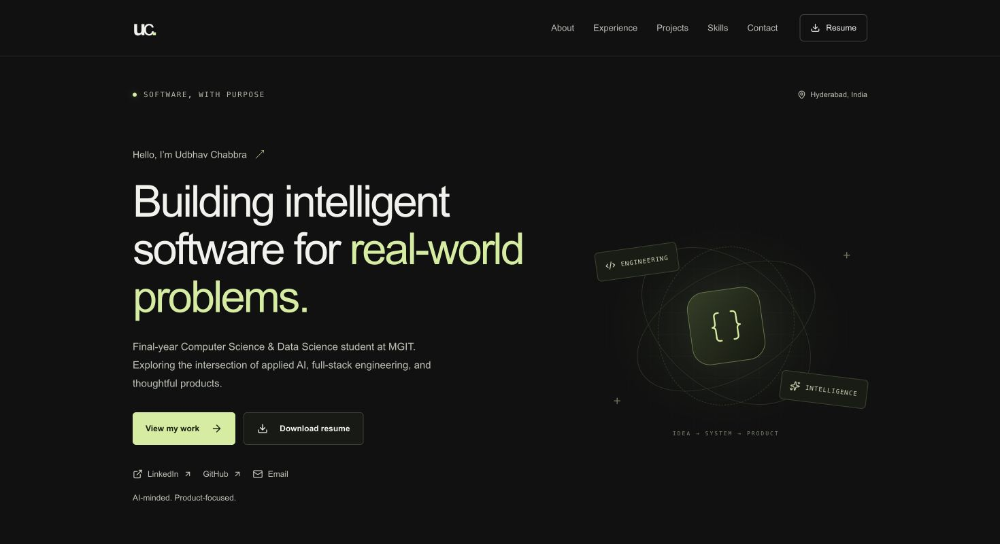
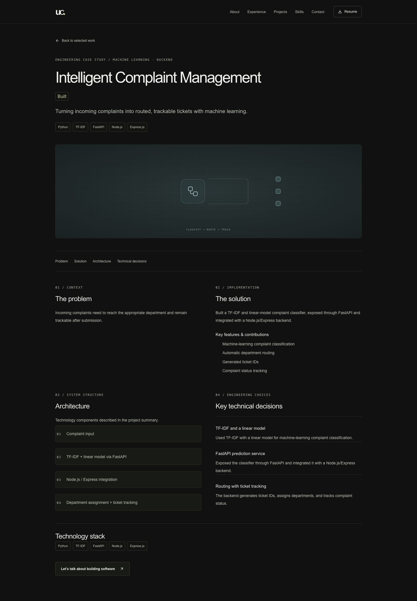

# Udbhav Chabbra — Portfolio

A personal portfolio for Udbhav Chabbra, showcasing software projects, engineering decisions, experience, and a downloadable resume. Built with a dark, responsive interface and dedicated case studies so visitors can explore the work beyond a project card.


## Preview

**Homepage** — introduction, navigation, and resume access.



**Project case study** — a closer look at the problem, solution, architecture, and technical decisions.



## What the site includes

- **Responsive design:** layouts adapt from desktop to mobile, including a mobile navigation menu.
- **Project case studies:** dedicated pages for three projects, with problem, solution, architecture, and technology details. BakeFlow AI is marked as in development.
- **Real project imagery:** BakeFlow AI uses application screenshots; other projects retain their abstract illustrations. Gallery images open at full resolution.
- **Considered motion:** progressive reveal animations use Motion, with reduced-motion preferences respected.
- **Accessibility:** semantic page structure, descriptive image text, labeled controls, keyboard-friendly navigation, and reduced-motion support.
- **Resume and contact:** a downloadable PDF resume alongside email and social links.
- **Shareable pages:** generated Open Graph imagery, a sitemap, and a robots route.

## Live demo

No public deployment URL is available in this README yet. Add a verified live URL here after deployment.

## Run locally

Use Node.js **20.9 or newer**. Install from the lockfile and start the development server:

```sh
npm ci
npm run dev
```

Open [http://localhost:3000](http://localhost:3000).

To run the project checks and test a production build locally:

```sh
npm run lint
npm run typecheck
npm run build
npm start
```

`npm start` serves the production build at [http://localhost:3000](http://localhost:3000). Stop the development server first if it is using that port.

## Content and project screenshots

Portfolio content, project status, external URLs, and screenshot captions are maintained in `lib/portfolio.ts`. Individual project repository and demo links are nullable; the site omits links that have not been supplied. Replace `public/Udbhav_Chabbra_Resume.pdf` when the resume changes.

BakeFlow AI screenshots are stored in `public/images/bakeflow/`. To add real captures for another project, place them in `public/screenshots/` and add entries to that project's `screenshots` array. Each entry needs a public path, descriptive alt text, a caption, and the original pixel width and height. The first image becomes the project-card cover and the featured gallery image. An empty array keeps the existing illustration.

## Project structure

| Path | Purpose |
| --- | --- |
| `app/` | Homepage, project routes, and metadata endpoints |
| `components/` | Reusable interface, project media, and interactions |
| `lib/portfolio.ts` | Portfolio content and project configuration |
| `app/globals.css` | Responsive styles and reduced-motion rules |
| `public/` | Resume and image assets |

## Deployment notes

This is a Next.js project that can be imported into Vercel from a Git repository. Keep the detected Next.js preset and default build settings. Set `NEXT_PUBLIC_SITE_URL` to the verified production origin, without a trailing slash, then check the project pages, resume download, `/sitemap.xml`, and `/robots.txt`.

For local metadata checks, copy `.env.example` to `.env.local` and set `NEXT_PUBLIC_SITE_URL`. Without a site URL, the sitemap intentionally returns no URLs. No backend service or secret is required for this portfolio.
